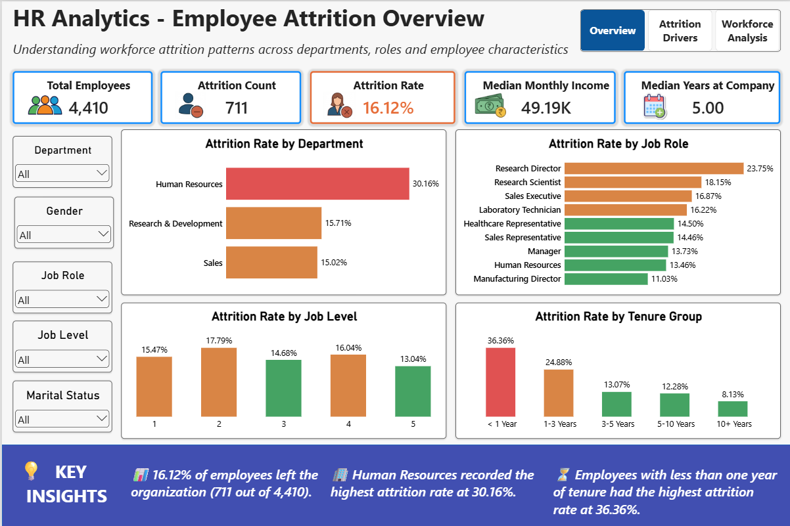
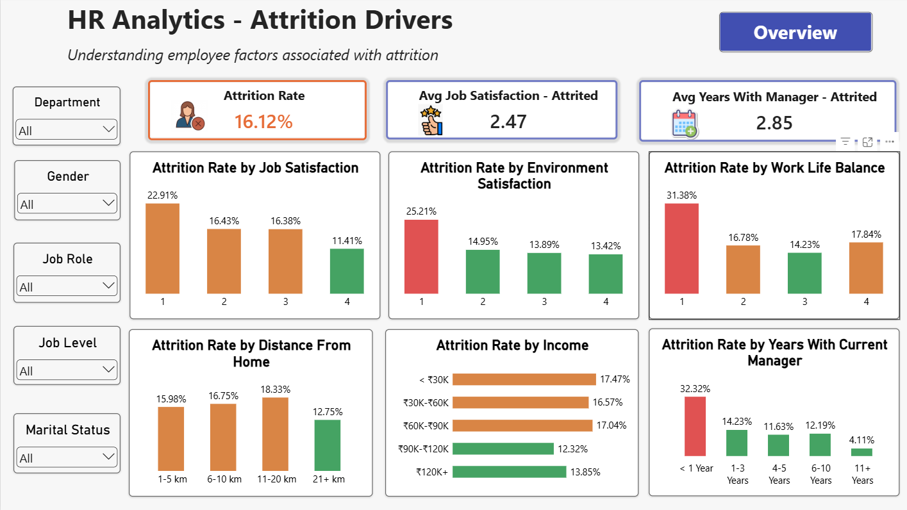
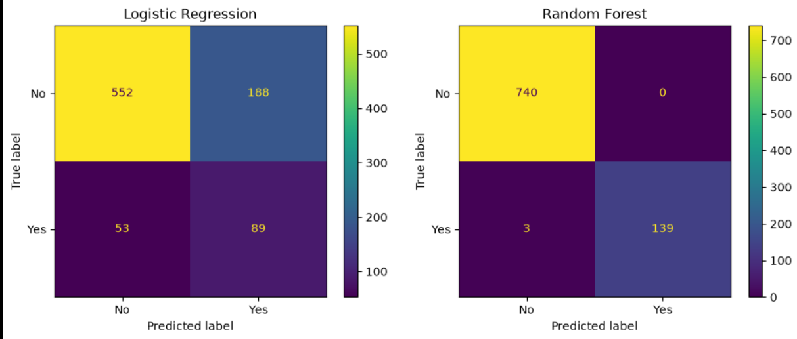

# 📊 HR Analytics — Employee Attrition

An end-to-end HR analytics project focused on understanding employee attrition patterns and predicting employee turnover using **Python, SQL, Machine Learning, SHAP, and Power BI**.

---

## 🎯 Objective

Analyze employee data to identify attrition patterns, understand key factors associated with employee turnover, and build a machine learning model for attrition prediction.

---

## 🛠️ Tools & Technologies

- 🐍 Python — Pandas, NumPy, Scikit-learn, SHAP
- 🗄️ SQL — Data analysis
- 📊 Power BI — Interactive dashboard
- 🤖 Machine Learning — Logistic Regression, Random Forest
- 🔍 SHAP — Model explainability

---

## 📁 Project Structure

```text
data/
├── raw/              # Original source files
└── processed/        # Cleaned and merged dataset

notebooks/
├── 01_eda.ipynb
├── 02_eda.ipynb
├── 03_modeling.ipynb
└── 04_shap_explainability.ipynb

models/               # Trained ML model
dashboard/            # Power BI dashboard
images/               # Project visuals
```

---

## 📊 Power BI Dashboard

### Employee Attrition Overview



### Attrition Drivers



The dashboard currently contains two pages covering overall attrition and employee factors associated with attrition. A third workforce analysis page will be added later.

---

## 🔎 Key Findings

- 👥 **4,410 employees** were analyzed.
- 📉 **711 employees** had left the organization.
- 📊 Overall attrition rate was **16.12%**.
- 🏢 Human Resources had the highest department-level attrition rate at **30.16%**.
- ⏳ Employees with **less than 1 year** at the company had the highest tenure-group attrition rate at **36.36%**.
- 😊 Attrition was higher among employees with lower job and environment satisfaction levels.
- 🏠 Employees living **11–20 km** from work showed an attrition rate of **18.33%**.

---

## 🤖 Machine Learning

Two classification models were evaluated:

| Model | F1-Score | ROC-AUC |
|---|---:|---:|
| Logistic Regression | — | — |
| Random Forest | **0.9893** | **0.9987** |

Random Forest achieved the higher performance on the test set.

### Model Evaluation



SHAP was also used to explain the model's global feature importance and individual predictions.

---

## 📌 Project Status

- ✅ Data cleaning & preprocessing
- ✅ Exploratory Data Analysis
- ✅ Machine Learning
- ✅ SHAP Explainability
- ✅ 2-page Power BI Dashboard
- 🔄 Third dashboard page
- 🔄 Final project report
