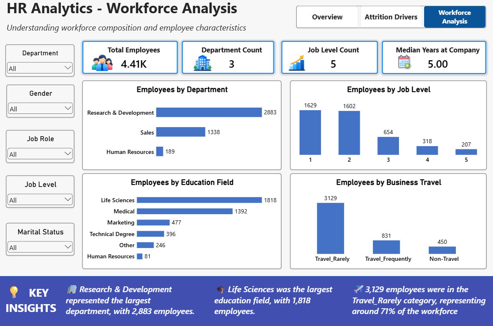

<div align="center">

# 📊 HR Analytics — Employee Attrition Analysis & Prediction

### Understanding Workforce Trends Through Data Analytics

An end-to-end HR analytics project combining **Python, Machine Learning, SHAP Explainability, and Power BI** to explore employee attrition patterns, examine workforce characteristics, and communicate data-driven insights.

<br>


</div>

---

## 📌 Project Overview

Employee attrition is an important workforce metric that helps organizations understand employee turnover and examine how workforce characteristics vary across departments, job roles, satisfaction levels, and tenure groups.

This project analyzes a consolidated HR dataset containing **4,410 employee records** to investigate attrition patterns and develop predictive classification models.

The analysis follows a structured workflow:

- 🧹 **Data Preparation:** Clean, validate, and consolidate multiple HR data tables.
- 🔎 **Exploratory Data Analysis:** Examine employee attrition across demographic, organizational, satisfaction, and tenure-related variables.
- 🤖 **Predictive Modeling:** Train and evaluate Logistic Regression and Random Forest classifiers.
- 🧠 **Model Explainability:** Use SHAP to examine feature contributions to model predictions.
- 📊 **Interactive Visualization:** Build a three-page Power BI dashboard covering attrition, potential attrition drivers, and workforce composition.

> **Project objective:** Identify meaningful patterns in the available HR data, evaluate predictive modeling approaches, and present findings in an accessible, interactive format.

---

## 📈 Dataset at a Glance

The consolidated dataset contains **4,410 employee records and 26 columns**, including the target variable, `Attrition`.

| Workforce Metric | Value |
|:---|---:|
| 👥 Total Employees | 4,410 |
| 🚪 Employees Who Left | 711 |
| 🏢 Employees Who Stayed | 3,699 |
| 📉 Overall Attrition Rate | **16.12%** |
| 🧹 Duplicate Rows After Cleaning | 0 |
| ⚠️ Missing Values After Cleaning | 0 |

### 🎯 What These Numbers Tell Us

- **16.12% overall attrition:** 711 out of 4,410 employees are recorded as having left.
- **3,699 employees stayed:** The majority of employees in the dataset did not leave.
- **Validated cleaned dataset:** The consolidated dataset contains no duplicate rows or missing values following the documented cleaning process.

*Note: These figures describe the analyzed dataset and should not be interpreted as industry-wide benchmarks.*

---

## 📊 Power BI Dashboard

The interactive Power BI dashboard is organized into three pages, each designed to answer a different set of business questions.

### 🟦 Page 1 — HR Analytics: Employee Attrition Overview

**Purpose:** Understand the overall attrition situation and identify how attrition rates vary across departments, job roles, job levels, and tenure groups.


**Key observations**

- **Overall attrition:** 16.12% of employees in the dataset left.
- **Departmental variation:** Human Resources recorded the highest department-level attrition rate at **30.16%**.
- **Early-tenure attrition:** Employees with less than one year at the company had an attrition rate of **36.36%**.

**Dashboard components**
- Total Employees, Attrition Count, Attrition Rate, Median Monthly Income, and Median Years at Company.
- Attrition Rate by Department.
- Attrition Rate by Job Role.
- Attrition Rate by Job Level.
- Attrition Rate by Tenure Group.

---

### 🟧 Page 2 — HR Analytics: Attrition Drivers

**Purpose:** Examine how attrition rates differ across employee satisfaction measures, work-life balance, distance from home, monthly income groups, and tenure with the current manager.


**Key observations**

- **Job satisfaction:** Employees at satisfaction level 1 had an attrition rate of **22.91%**, compared with **11.41%** at level 4.
- **Environment satisfaction:** The lowest satisfaction level had an attrition rate of **25.21%**.
- **Manager tenure:** Employees with less than one year under their current manager had an attrition rate of **32.32%**.

**Dashboard components**
- Attrition Rate.
- Average Job Satisfaction among employees who left.
- Average Years With Current Manager among employees who left.
- Attrition Rate by Job Satisfaction.
- Attrition Rate by Environment Satisfaction.
- Attrition Rate by Work-Life Balance.
- Attrition Rate by Distance From Home Group.
- Attrition Rate by Monthly Income Group.
- Attrition Rate by Years With Current Manager Group.

> **Interpretation note:** These comparisons show associations within the dataset. They do not establish that any individual factor directly causes employee attrition.

---

### 🟩 Page 3 — HR Analytics: Workforce Analysis

**Purpose:** Understand workforce composition across departments, job levels, education fields, and business travel categories.



**Key observations**

- **Largest department:** Research & Development, with **2,883 employees**.
- **Largest education field:** Life Sciences, with **1,818 employees**.
- **Business travel:** The `Travel_Rarely` category contains **3,129 employees**, approximately **70.95%** of the workforce.

**Dashboard components**
- Total Employees.
- Department Count.
- Job Level Count.
- Median Years at Company.
- Employee Distribution by Department.
- Employee Distribution by Job Level.
- Employee Distribution by Education Field.
- Employee Distribution by Business Travel.

---

### 🎛️ Interactive Dashboard Features

All three pages include slicers for:

- Department
- Gender
- Job Role
- Job Level
- Marital Status

These filters allow users to explore workforce composition and attrition patterns across selected employee groups.

---

## 🧹 Data Preparation & Quality Checks

Reliable analysis begins with consistent, well-structured data. The project consolidates multiple HR data tables into a single employee-level dataset for exploratory analysis and predictive modeling.

### 🔧 Data Preparation Workflow

1. **Data Inspection** — Examined the source tables, column structures, data types, and available employee attributes.
2. **Data Cleaning** — Reviewed data quality issues and prepared the source tables for consolidation.
3. **Data Consolidation** — Combined the relevant HR tables into a unified employee-level dataset.
4. **Data Validation** — Checked the consolidated dataset for missing values and duplicate rows.
5. **Feature Preparation** — Prepared employee attributes for exploratory analysis and subsequent machine learning workflows.

### ✅ Final Dataset Validation

| Validation Check | Result |
|:---|:---|
| Consolidated Records | 4,410 |
| Total Columns | 26 |
| Duplicate Rows | 0 |
| Missing Values | 0 |
| Target Variable | `Attrition` |

The resulting dataset provides a consistent foundation for analyzing employee characteristics, comparing attrition rates, and preparing features for classification models.

---

## 🔎 Exploratory Data Analysis (EDA)

Exploratory Data Analysis was conducted to understand the distribution of employee attributes and examine how attrition varies across different workforce segments.

The analysis covers organizational structure, job characteristics, employee satisfaction, income, and tenure-related variables.

### 🎯 Key Business Questions

The analysis was structured around the following questions:

| # | Business Question | Analytical Focus |
|:--:|:---|:---|
| 1 | What proportion of employees left the organization? | Overall attrition rate |
| 2 | How does attrition vary across departments? | Department-level attrition |
| 3 | Which job roles have comparatively higher attrition? | Job-role comparison |
| 4 | Does attrition vary across job levels? | Job-level comparison |
| 5 | How is attrition associated with employee tenure? | Years at company |
| 6 | How does job satisfaction relate to attrition? | Job satisfaction levels |
| 7 | How does environment satisfaction relate to attrition? | Workplace environment |
| 8 | How does work-life balance relate to attrition? | Work-life balance ratings |
| 9 | How does attrition vary across manager-tenure groups? | Years with current manager |
| 10 | How is the workforce distributed across major employee categories? | Workforce composition |

---

## 📊 EDA Findings

### 1. Overall Attrition

The dataset contains 4,410 employees, of whom 711 left the organization.

| Metric | Value |
|:---|---:|
| Employees Who Left | 711 |
| Employees Who Stayed | 3,699 |
| Overall Attrition Rate | **16.12%** |

This establishes the baseline against which attrition rates across different employee groups can be compared.

### 2. Attrition Across Departments

| Department | Employees | Employees Who Left | Attrition Rate |
|:---|---:|---:|---:|
| Human Resources | 189 | 57 | **30.16%** |
| Research & Development | 2,883 | 453 | 15.71% |
| Sales | 1,338 | 201 | 15.02% |

**Key insight:** Human Resources recorded the highest department-level attrition rate at 30.16%, substantially above the overall dataset rate of 16.12%.

Although Research & Development had the largest number of employees who left, its attrition rate was lower than that of Human Resources. This illustrates why employee counts and attrition rates should be interpreted separately.

### 3. Attrition Across Job Roles

- **Research Director** recorded the highest job-role attrition rate at **23.75%**.
- **Manufacturing Director** recorded the lowest job-role attrition rate at **11.03%**.

These differences highlight variation across job roles. They do not, by themselves, establish the reasons behind that variation.

### 4. Attrition Across Job Levels

- Job Level 2 recorded the highest attrition rate at **17.79%**.
- Job Level 5 recorded the lowest attrition rate at **13.04%**.

The results do not show a consistent increase or decrease in attrition across successive job levels.

### 5. Attrition and Employee Tenure

Employees with less than one year at the company recorded an attrition rate of **36.36%**, the highest among the analyzed tenure groups.

The analysis generally shows lower attrition across longer-tenure groups, with a slight increase in the group with 16 or more years at the company.

**Key insight:** Early tenure stands out as an important segment for further investigation. The observed relationship does not establish that tenure itself causes attrition.

### 6. Attrition and Employee Satisfaction

| Factor | Finding |
|:---|:---|
| Job Satisfaction | Level 1: 22.91% attrition |
| Job Satisfaction | Level 4: 11.41% attrition |
| Environment Satisfaction | Lowest satisfaction level: 25.21% attrition |
| Work-Life Balance | Lowest category: 31.38% attrition |

**Key insight:** Employees in the lowest satisfaction categories generally showed higher attrition rates than employees in the highest job-satisfaction category.

These patterns can help prioritize further investigation into employee experience, but they should not be interpreted as proof of causation.

### 7. Attrition and Manager Tenure

Employees with less than one year under their current manager recorded an attrition rate of **32.32%**.

The group with 11 or more years under the current manager recorded the lowest rate at **4.11%**.

**Key insight:** Attrition differed considerably across manager-tenure groups. Additional investigation would be required to understand the organizational or employee-level factors associated with these differences.

### 8. Workforce Composition

The workforce distribution analysis identified the following characteristics:

| Workforce Attribute | Finding |
|:---|:---|
| Largest Department | Research & Development |
| Employees in Research & Development | 2,883 |
| Largest Education Field | Life Sciences |
| Employees in Life Sciences | 1,818 |
| Most Common Business Travel Category | `Travel_Rarely` |
| Employees in `Travel_Rarely` | 3,129 |
| Share of Employees in `Travel_Rarely` | Approximately 70.95% |

These findings provide context for interpreting attrition results by showing how employees are distributed across major workforce categories.

---

## 💡 Key Takeaways from EDA

- **Departmental variation:** Human Resources had the highest department-level attrition rate at 30.16%.
- **Early-tenure attrition:** Employees with less than one year at the company had a 36.36% attrition rate.
- **Satisfaction differences:** The lowest job-satisfaction and environment-satisfaction categories showed comparatively high attrition rates.
- **Manager-tenure differences:** Employees with less than one year under their current manager had a 32.32% attrition rate.
- **Workforce context:** Research & Development was the largest department, with 2,883 employees.

> **Analytical limitation:** EDA identifies patterns and associations in the available dataset. It does not independently establish causation or prove that changing a particular employee attribute would reduce attrition.

## 🤖 Machine Learning & Predictive Modeling

Following exploratory analysis, machine learning classification models were developed to investigate whether employee attributes could help distinguish between employees who left and those who stayed.

The target variable is `Attrition`, and the modeling workflow compares Logistic Regression with Random Forest.

### 🧩 Modeling Workflow

The modeling process follows these steps:

1. **Feature Preparation** — Excluded `EmployeeID` and prepared the predictor variables for modeling.
2. **Target Definition** — Used `Attrition` as the classification target.
3. **Train/Test Split** — Split the data into training and test sets using stratified sampling.
4. **Preprocessing** — Applied one-hot encoding to categorical features and standard scaling to numerical features.
5. **Model Training** — Trained Logistic Regression and Random Forest classifiers.
6. **Model Evaluation** — Compared the models using accuracy, precision, recall, F1-score, and ROC-AUC.

### ⚙️ Model Configuration

| Setting | Configuration |
|:---|:---|
| Total Records | 4,410 |
| Predictor Features | 24 |
| Training Set | 3,528 records (80%) |
| Test Set | 882 records (20%) |
| Train/Test Random State | 42 |
| Split Strategy | Stratified |
| Categorical Encoding | One-Hot Encoding |
| Numerical Scaling | Standard Scaling |
| Logistic Regression | `class_weight="balanced"` |
| Random Forest | 200 trees |
| Random Forest Class Weight | `class_weight="balanced"` |
| Random Forest Random State | 42 |

The preprocessing steps were implemented within the modeling pipeline to maintain a consistent transformation process between training and prediction.

---

## 📏 Model Evaluation

The classifiers were evaluated using five metrics to compare overall correctness, positive predictions, attrition detection, and ranking performance.

### 📊 Performance Comparison

| Evaluation Metric | Logistic Regression | Random Forest |
|:---|---:|---:|
| Accuracy | 72.68% | 99.66% |
| Precision | 32.13% | 100.00% |
| Recall | 62.68% | 97.89% |
| F1-Score | 42.48% | 98.93% |
| ROC-AUC | 78.29% | 99.87% |

**Reported result:** Random Forest achieved substantially higher scores than Logistic Regression across the recorded evaluation metrics.

However, the unusually high Random Forest scores require additional validation before they can be treated as evidence of reliable predictive performance on unseen data.

### 🔍 Confusion Matrix

The recorded test-set confusion matrices are shown below.

| Outcome | Logistic Regression | Random Forest |
|:---|---:|---:|
| True Negatives (TN) | 552 | 740 |
| False Positives (FP) | 188 | 0 |
| False Negatives (FN) | 53 | 3 |
| True Positives (TP) | 89 | 139 |

These results illustrate different classification behavior:

- **Logistic Regression** identified a portion of employees who left but also produced a substantial number of false-positive predictions.
- **Random Forest** recorded very few missed attrition cases and no false positives in the reported test results.

> **Model Evaluation Note:** Random Forest achieved substantially higher evaluation scores than Logistic Regression on the held-out test set. Feature selection, preprocessing, and model evaluation were implemented using a structured machine learning pipeline. These results describe performance on the current dataset and should not be assumed to generalize directly to other employee populations.


---

## 🧠 SHAP Explainability

Model performance alone does not explain which features influence predictions. SHAP (SHapley Additive exPlanations) was used to examine feature contributions to the Random Forest model's predictions.

SHAP provides a framework for interpreting model outputs by estimating how individual features contribute to predictions relative to a reference value.

### 🔑 Leading Features by Mean Absolute SHAP Value

| Feature | Mean Absolute SHAP Value |
|:---|---:|
| Age | 0.0511 |
| Years at Company | 0.0431 |
| Total Working Years | 0.0402 |
| Years With Current Manager | 0.0377 |
| Marital Status — Single | 0.0350 |
| Environment Satisfaction | 0.0322 |
| Job Satisfaction | 0.0253 |
| Monthly Income | 0.0233 |

### 📌 Interpretation

- **Age and work experience:** Age, total working years, and years at the company were among the leading features by mean absolute SHAP value.
- **Manager tenure:** Years with the current manager also contributed to model predictions.
- **Employee experience:** Environment satisfaction and job satisfaction appeared among the leading features.
- **Marital status:** The encoded feature `MaritalStatus_Single` was another notable contributor.

Mean absolute SHAP values indicate the average magnitude of a feature's contribution to model output. They do not, by themselves, indicate whether a feature increases or decreases attrition risk, nor do they establish causation.

### 🧭 Explaining an Individual Prediction

The explainability workflow also examined an individual employee prediction using a SHAP waterfall plot.

For the documented example, the model predicted **No Attrition**, with an output value of approximately **0.025**.

This example illustrates how SHAP can be used to inspect the contributions of individual features to a model prediction.

---

## ⚖️ Modeling Limitations

Several considerations are important when interpreting these results:

- **Unusually high performance:** The Random Forest scores require additional validation before they can be considered reliable estimates of performance on unseen employees.
- **Dataset scope:** The results describe the analyzed dataset and may not generalize to other organizations or workforces.
- **Associations versus causes:** Feature importance and SHAP explanations describe model behavior, not causal relationships.
- **Decision support:** Predictive outputs should not be treated as definitive judgments about individual employees.

The modeling component demonstrates a structured classification and explainability workflow while highlighting the importance of validation, careful interpretation, and responsible use of employee data.

## 🛠️ Technology Stack

| Technology | Purpose |
|:---|:---|
| 🐍 Python | Data preparation, analysis, and modeling |
| 🐼 Pandas | Data manipulation and consolidation |
| 🔢 NumPy | Numerical operations |
| 📊 Matplotlib & Seaborn | Exploratory data visualization |
| 🤖 Scikit-learn | Preprocessing, classification, and model evaluation |
| 🧠 SHAP | Model explainability |
| 📈 Power BI | Interactive dashboards and workforce analysis |
| 📓 Jupyter Notebook | Reproducible analysis workflow |

---

## 📁 Repository Structure

The repository is organized to separate source data, processed data, analysis notebooks, model artifacts, and dashboard files.

```text
hr-analytics-employee-attrition/
│
├── data/
│   ├── raw/
│   │   ├── general_data.csv
│   │   ├── employee_survey_data.csv
│   │   ├── manager_survey_data.csv
│   │   └── data_dictionary.xlsx
│   │
│   └── processed/
│       └── hr_employee_master.csv
│
├── notebook/
│   ├── 01_data_profiling_cleaning.ipynb
│   ├── 02_eda.ipynb
│   ├── 03_modeling.ipynb
│   └── 04_shap_explainability.ipynb
│
├── models/
│   └── random_forest_pipeline.pkl
│
├── dashboard/
│   └── HR_Analytics_Employee_Attrition.pbix
│
├── images/
│   ├── dashboard_overview.png
│   ├── dashboard_attrition_drivers.png
│   ├── dashboard_workforce_analysis.png
│   ├── eda_monthly_income_distribution.png
│   ├── eda_attrition_by_tenure.png
│   └── model_confusion_matrix.png
│
└── README.md
